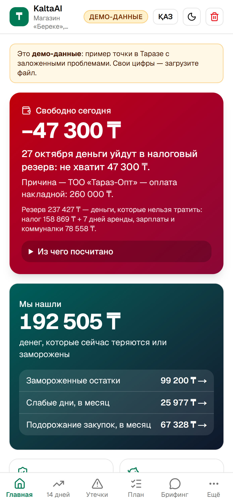
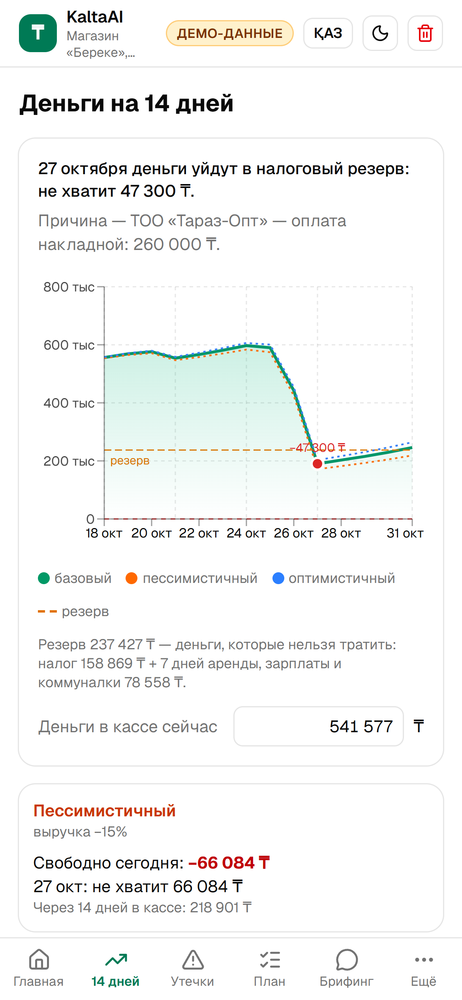
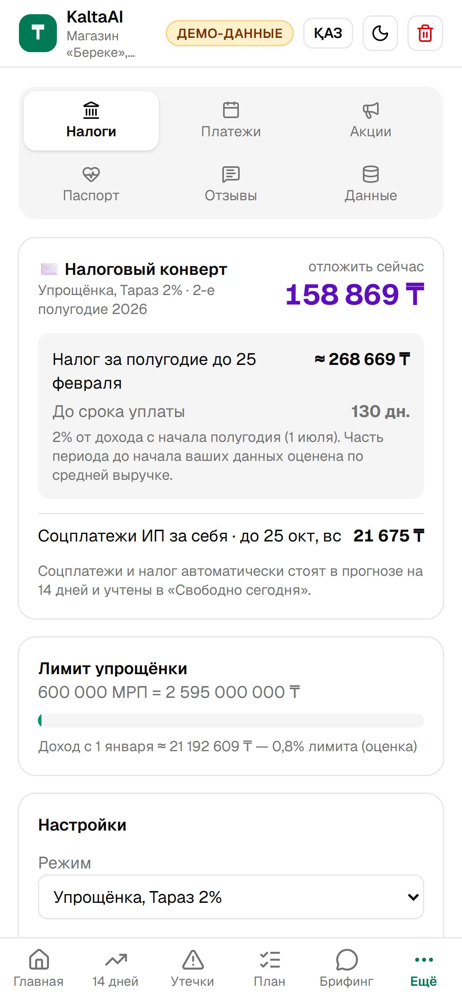

# KaltaAI — ИИ-финдиректор для бизнеса Тараза

**🌐 Сайт:** https://kaltaai.vercel.app · **🎬 Питч и демо за 2 минуты:** https://kaltaai.vercel.app/pitch · **🤖 Telegram-бот:** [@KaltaAI_Bot](https://t.me/KaltaAI_Bot) · **Код:** https://github.com/zxcllxc/kaltaai

Трек **AI for SME & Local Business** (Zhambyl Hub). Работает на телефоне без установки, на русском и казахском.

| Свободно сегодня | Прогноз с резервом | Налоговый конверт |
|---|---|---|
|  |  |  |

## Проблема
Владелец магазина, кафе, салона или СТО в Таразе ведёт учёт в тетради, Excel или смотрит выписку Kaspi. Он видит, сколько продал вчера, но не видит:
- что **через 9 дней**, после оплаты поставщику, придётся тратить деньги, отложенные на налог;
- что на полке **заморожено 99 тыс ₸** в товаре, который не продаётся почти два месяца;
- что молочный поставщик тихо **поднял цены на 13%**, а вторник стабильно проседает на 44%.

## Что умеет
1. **Свободно сегодня** — одна главная цифра: сколько денег можно тратить сегодня, чтобы хватило на все платежи 14 дней и на резерв (налог + 7 дней аренды, зарплаты, коммуналки). Под ней одна фраза о ближайшем риске (в демо: через 9 дней, после оплаты поставщику, деньги уйдут в налоговый резерв — не хватит 47 300 ₸) и разбор «из чего посчитано».
2. **Прогноз денег на 14 дней** — график с линией резерва, 3 сценария, «что если» (скидка на залежавшийся товар, перенос платежа, подъём цен) — пересчёт мгновенно.
3. **Налоговый конверт 2026** — Тараз 2% / 4% / ОУР с НДС 16% / своя ставка; сколько отложить сейчас, сколько и до какого числа платить, соцплатежи ИП, лимит упрощёнки, порог НДС. Платежи сами попадают в прогноз.
4. **Мы нашли X ₸** — замороженные остатки, слабые дни недели, подорожание у поставщиков; ABC-анализ и маржа по товарам.
5. **План** — 3–5 действий на человеческом языке с эффектом в ₸ и сроком; «выполнено» копит реально сэкономленное.
6. **Утренний брифинг** в стиле Telegram + чат «Спроси KaltaAI» с 5 кнопками-вопросами.
7. **Telegram-бот** [@KaltaAI_Bot](https://t.me/KaltaAI_Bot): `/start` → выбор бизнеса → брифинг (свободно сегодня, ближайший риск, налоговый конверт, одно действие в ₸), `/brief`, RU и KZ. Демо-данные.
8. **Импорт** CSV / Excel / Kaspi Pay (все листы, возвраты, комиссии), 1С-отчёты, казахские и английские заголовки; **быстрый старт без файла** (5 вопросов: «85к», «85 мың», «1,2 млн»); **фото тетради или чека** → таблица на проверку → запись только после «Да».
9. **Акции** по залежавшемуся товару с постами для Instagram/WhatsApp на RU и KZ; **разбор отзывов** 2ГИС/Instagram; **паспорт финансового здоровья** 0–100 в PDF (не является кредитным решением).
10. Полностью на **казахском и русском**, тёмная/светлая тема, работает на медленном 3G (кнопка демо видна через ~2,5 с), без JavaScript показывает лендинг.

## Архитектура: код считает → ИИ объясняет
```
CSV / Excel / Kaspi Pay / фото / 5 вопросов
        │  importer.ts (колонки RU/KZ/EN, возвраты, комиссии)
        ▼
analytics.ts — ВСЕ числа: прогноз 14 дней, «свободно сегодня», резерв, утечки, действия, эффект в ₸
tax/kz2026.ts + envelope.ts — налоговые ставки 2026 и конверт (один файл, источники в комментарии)
        │  готовые цифры строками (агрегаты, без сырых данных)
        ▼
/api/advice — NVIDIA NIM (openai/gpt-oss-20b) только переформулирует;
              ответ с числом, которого нет в фактах, отбрасывается → показывается шаблон
```
- Сырые данные остаются в браузере (localStorage); на сервер уходят только итоговые цифры. «Удалить мои данные» стирает всё.
- Лимиты ИИ: по IP и на инстанс, вопрос до 300 символов, таймаут 10 с; без ключа или при сбое всё работает на шаблонах.
- Демо-данные детерминированы и не «едут»: в любой день нехватка через 9 дней и те же суммы. Для демо ИИ-тексты сгенерированы заранее (`src/lib/demo-ai.ts`), поэтому на питче всё появляется мгновенно.
- Новое — за feature-флагами (`src/lib/flags.ts`): бот, быстрый старт, фото (включены), голос (выключен).

## Как запустить
```bash
npm install
cp .env.example .env.local   # ключи необязательны
npm run dev                  # http://localhost:3000
```
Переменные: `NVIDIA_API_KEY` (тексты ИИ и фото), `TELEGRAM_BOT_TOKEN` (бот). Без ключей всё работает на шаблонах. Перегенерировать ИИ-тексты демо: `npx tsx scripts/gen-demo-ai.mts https://kaltaai.vercel.app`.

## Формат данных
Подойдёт почти любая таблица: колонки угадываются по названиям (дата/күні, товар/тауар/наименование, количество/саны, сумма/сомасы/итого, тип/түрі/операция, поставщик/жеткізуші/контрагент, приход/расход, возврат/қайтару, комиссия), шапка выписки над таблицей пропускается. Понимаются суммы `+ 12 500,00 ₸`, `1.234,56`, даты `dd.mm.yyyy`, `yyyy-mm-dd` и даты Excel. «Поступление товаров» из 1С — закупка; аренда, зарплата, налоги определяются по словам. Если дату или сумму не распознали — экран ручного сопоставления колонок.

## Как считается
- **Прогноз:** средняя выручка по дням недели за 4 недели; закупки в той же доле от выручки; платежи из календаря и налогового конверта.
- **Резерв** = налог за текущий период (по ставке режима) + 7 дней фиксированных расходов (аренда, зарплата, коммуналка, соцплатежи).
- **Свободно сегодня** = самая низкая точка остатка за 14 дней (включая сейчас) − резерв. Если меньше нуля — день, когда остаток опускается ниже резерва, и сумма нехватки (это одно и то же число).
- **Мёртвые остатки:** закуплено − продано > 0 и нет продаж 30+ дней; **слабый день:** на 12%+ ниже медианы; **рост цен:** закупка за 4 недели против предыдущих 4, порог 4%.
- **Предотвращённый разрыв:** нехватка сейчас минус нехватка после шагов 1–2 (перенос платежа на 7 дней + скидка 30% на остатки).

## Источники налоговых параметров 2026
Все значения — в `src/lib/tax/kz2026.ts`, редактируются в «Ещё → Налоги». Расчёт ориентировочный, не налоговая консультация.
- МРП 4 325 ₸, МЗП 85 000 ₸ — Закон о республиканском бюджете на 2026–2028 ([tengrinews](https://tengrinews.kz/kazakhstan_news/utverjden-novyiy-mrp-na-2026-god-v-kazahstane-586608/))
- Упрощёнка в Таразе 2% — решение Таразского гормаслихата от 31.10.2025 № 33-4 (cdb.kz)
- НДС 16%, порог 10 000 МРП — НК РК № 214-VIII от 18.07.2025 ([uchet.kz](https://uchet.kz/week/nalogi-2026/))
- Упрощёнка 4%, лимит 600 000 МРП ([bcc.kz](https://bcc.kz/bcc-journal/simplified-regime/))
- Соцплатежи ИП от 21 675 ₸/мес до 25 числа ([calk.kz](https://calk.kz/calculator/ip-payments/))

## Честные ограничения
- Прогноз простой (средние по дням недели), сезонность и праздники не учитываются.
- Эластичность спроса (+10% цены → −5% продаж) и продаваемость при скидке — допущения, они подписаны в интерфейсе.
- Остаток в кассе для загруженного файла оценивается — его нужно уточнить.
- Без закупок в файле нельзя посчитать мёртвые остатки и маржу; без названий товаров — ABC.
- Разбор отзывов работает по словарю; ИИ пишет только ответ и задачу.
- Голосовой ввод выключен: в NVIDIA NIM распознавание речи доступно только по gRPC, через наш REST-ключ его нет. Подойдёт бесплатный ключ Groq (whisper-large-v3, понимает ru и kk).
- Бот работает на демо-данных; свои данные — на сайте.

## Дорожная карта
1. Kaspi Pay / Kaspi Магазин и 1С по API — без ручной выгрузки.
2. Бот присылает брифинг сам каждое утро в 8:00 по данным владельца.
3. Голосовой ввод (Groq Whisper), отзывы 2ГИС через официальный API.
4. Пилоты с 5 точками в Таразе, сверка прогноза с фактом.
5. Паспорт здоровья как заявка на микрокредит в партнёрском банке / фонде «Даму».

## Стек
Next.js 16 (App Router, SSR) · React 19 · Tailwind 4 · shadcn/ui · Recharts · PapaParse + SheetJS · grammY · NVIDIA NIM · Vercel
